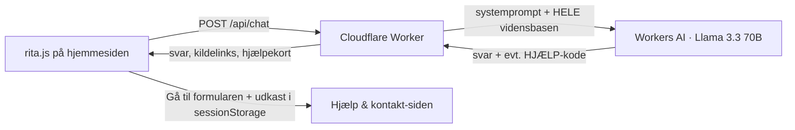

# Rita – Rent Hernings chatbot

Rita er en dansk (og engelsk) chatbot til Rent Hernings hjemmeside. Hun svarer **kun ud fra husordenen og privatlivsdokumentet (GDPR)**, og hun hjælper lejeren videre til den rigtige person: Når nogen skal have noget gjort, viser Rita et kort, der åbner den rigtige mulighed på siden *Hjælp & kontakt* med hendes udkast allerede skrevet ind i beskedfeltet. Ved akutte skader viser hun telefonnummeret og 112 først, og boligsøgende sendes til *Ledige boliger*.

Hele løsningen kører på én Cloudflare Worker, der serverer widget-scriptet og kalder Cloudflare Workers AI. Ved få henvendelser om dagen ligger det inden for Cloudflares gratis kvote. Hjemmesiden indsætter én linje:

```html
<script src="https://rita-robot.philip15.workers.dev/rita.js" defer
        data-site="/" data-lang="da" data-emergency-phone="12 34 56 78"></script>
```

| Attribut | Betydning |
|---|---|
| `data-site` | Hjemmesidens rod, fx `/` på rentherning.dk eller `/website/` på GitHub Pages |
| `data-lang` | `da` eller `en` (standard: sidens `<html lang>`). Rita svarer på brugerens sprog uanset |
| `data-emergency-phone` | Vises som "Ring til os nu" på akut-kortet. Uden nummer henviser Rita til siden Hjælp & kontakt |

## Sådan hænger det sammen



Vidensbasen er så lille (35 afsnit, ca. 5.000 tokens), at hele den sendes med hver gang. Så kan modellen ikke "mangle" et afsnit, og engelske spørgsmål virker lige så godt som danske. Søgningen (BM25) bruges kun til at vælge de 1–2 kildelinks, der vises under svaret.

| Kilde | Fil | Afsnit | Opdateres ved |
|---|---|---|---|
| Husorden | `data/sources/husorden.md` | 16 | Ny PDF på hjemmesiden |
| Privatlivsdokument (GDPR) | `data/sources/gdpr.md` | 10 | Ny PDF på hjemmesiden |
| Sådan får du hjælp | `data/sources/kontakt.md` | 9 | Når hjælpesiden eller Rent Hernings regler for henvendelser ændres |

Lejeloven er fjernet: Rita giver ikke juridisk rådgivning, og spørgsmål uden for husorden og GDPR sendes videre til Rent Herning under *Andre spørgsmål*.

Hjælpekortene følger hjælpesidens muligheder:

| Kode | Mulighed på hjemmesiden | Bruges når |
|---|---|---|
| `akut` | Akut skade | Kun brand, vandskade eller andet, der ikke kan vente. Vises altid, hvis brugeren nævner brand eller vandskade |
| `vicevaert` | Noget skal ordnes | Noget skal repareres eller ordnes |
| `syn` | Fejl og mangler efter indflytning | Fejl fundet inden for 14 dage efter indflytning |
| `opsigelse` | Jeg vil flytte | Brugeren vil opsige |
| `andet` | Andre spørgsmål | Husleje, kontrakt, eller når Rita ikke kan svare |
| `boliger` | Ledige boliger | Brugeren søger en bolig |

Ritas udkast overføres til formularen via `sessionStorage` (nøgle `rita-prefill-v2`), ikke via adresselinjen, så lejerens tekst ikke havner i serverlogs.

## Rate limiting

Rita har to lag, så ingen enkelt person og ingen bot kan bruge hele AI-kvoten:

| Lag | Grænse | Hvordan | Gemmer |
|---|---|---|---|
| Pr. besøgende | 10 beskeder pr. minut pr. IP | Cloudflares rate-limit-binding `RATE_LIMITER` | Intet – Cloudflare tæller |
| For alle tilsammen | `DAILY_LIMIT` spørgsmål pr. døgn (standard 500) | Én tæller pr. dag i KV-navnerummet `RITA_LIMITS` | Kun ét tal pr. dag (slettes efter 3 dage) – ingen IP-adresser eller tekster |

Rammer man en grænse, svarer Rita venligt på brugerens sprog (dansk/engelsk) og henviser til siden Hjælp & kontakt. Begge lag fejler åbent: Har Cloudflare et hikke, svarer Rita hellere end at gå i stå. KV er "eventually consistent", så det daglige loft er omtrentligt.

Det daglige loft skal slås til én gang:

```bash
npx wrangler kv namespace create RITA_LIMITS
```

Indsæt det `id`, kommandoen skriver, i `worker/wrangler.toml` under `[[kv_namespaces]]`, og fjern `#` foran de tre linjer. Loftet ændres med `DAILY_LIMIT` samme sted.

## Kom i gang

Du skal bruge Node 20+ og en gratis Cloudflare-konto.

```bash
cd worker
npm install
npm test                      # søge-, parser- og chat-tests med falsk model (ingen konto nødvendig)
node dev/mock-server.mjs      # lokal demo med falsk AI: http://localhost:8787/demo.html
npx wrangler login
npm run deploy                # bygger vidensbasen og deployer
```

Efter deploy kan botten afprøves på `https://rita-robot.philip15.workers.dev/demo.html`. Den nye hjemmeside (repo `RentHerning/website`) indsætter scriptet selv. Domæner, der må bruge chatten, står i `ALLOWED_ORIGINS` i `worker/wrangler.toml` (rentherning.dk, demoen på rentherning.github.io og localhost); andre domæner får afvist deres kald.

## Skift sprogmodel

Workers AI er standard. Modellen skiftes med `MODEL` i `wrangler.toml` (fx `@cf/mistralai/mistral-small-3.1-24b-instruct` eller `@cf/google/gemma-3-12b-it`). Workeren kan også tale med enhver OpenAI-kompatibel API. Det gælder fx Claude, OpenAI eller en Hugging Face Inference Endpoint med en dansk model:

```toml
LLM_PROVIDER = "openai-compatible"
LLM_BASE_URL = "https://api.anthropic.com/v1"
LLM_MODEL    = "claude-haiku-4-5"
```

```bash
npx wrangler secret put LLM_API_KEY
```

En bemærkning om `mhenrichsen/danskgpt-tiny`: det er en lille model på omkring 1 mia. parametre. Den kan ikke køre direkte på Workers AI, og den er for lille til pålideligt at følge regler og citere lovtekst. Den skal i givet fald hostes som Hugging Face Endpoint og kobles på via variablerne ovenfor. Med hele vidensbasen i prompten (ca. 5.000 tokens) skal modellen desuden have et kontekstvindue på mindst 8.000 tokens.

## Opdatering af vidensbasen

Ret markdown-filerne i `data/sources/`. Hvert `## `-afsnit bliver én søgbar bid. Kør derefter `npm run deploy`. Står der en linje `Side: https://…` i et afsnit, linker Rita til den side som kilde.

## Vigtige forbehold

Lejeloven i vidensbasen er den oprindelige LOV nr. 341 af 22/03/2022. Retsinformation har endnu ikke udgivet en samlet lovbekendtgørelse, og loven er ændret otte gange siden (senest LOV nr. 615 af 30/06/2026). Rita gør derfor opmærksom på at tjekke den gældende tekst ved tvivl. Når der kommer en ny lovbekendtgørelse, erstattes `data/raw/lejeloven.txt` med dens tekst (`pdftotext fil.pdf data/raw/lejeloven.txt`).

Husordenen har forrang. Den er de regler, Rent Herning kører efter, så Rita svarer ud fra husordenen, når den dækker emnet, også hvor den afviger fra lejeloven. Kilderne prioriteres i rækkefølgen husorden, hjemmeside, GDPR og lejelov. Det sker både i søgningen (vægtning) og i prompten. Husordenen henviser til paragrafnumre fra den tidligere lejelov (§ 27, § 83, § 93). Det er nævnt for ledelsen, men Rita gengiver husordenen, som den er.

Rita gemmer ingen samtaler på serveren. Samtalen ligger kun i brugerens browserfane (sessionStorage) og forsvinder, når fanen lukkes. Widgetten beder brugeren om ikke at skrive personoplysninger, og formularerne klarer alt personligt. Cloudflare Workers AI behandler teksten under Cloudflares databehandlervilkår. Det bør nævnes i Rent Hernings privatlivstekst, før botten går live.

## Mappestruktur

```
data/sources/*.md          håndskrevne/uddragne kilder (husorden, GDPR, hjemmeside)
data/raw/lejeloven.txt     lovtekst udtrukket fra retsinformation-PDF
scripts/build-knowledge.mjs  bygger worker/src/knowledge.json
worker/src/index.js        Worker: API, CORS, rate limit, modelkald
worker/src/retrieval.js    BM25-søgning med dansk stemming og synonymer
worker/src/prompt.js       systemprompt og formularer
worker/public/rita.js      widget (shadow DOM, ingen afhængigheder)
worker/public/demo.html    testside
worker/dev/mock-server.mjs lokal test uden Cloudflare
```
